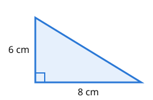

# Math
work: 10 min
lag: 2 min

## difficulty: high
What is the area of this right triangle?

- [ ] 14 cm²
- [x] 24 cm²
- [ ] 48 cm²
- [ ] 10 cm²

## difficulty: high
Solve for $x$: $\frac{3x}{4} = 18$

- [ ] 13.5
- [ ] 22
- [x] 24
- [ ] 54

## difficulty: high
Which of these numbers are prime?

- [x] 29
- [ ] 39
- [ ] 51
- [x] 53

## difficulty: medium
What is $\frac{3}{4}$ of 24?

- [ ] 16
- [x] 18
- [ ] 20
- [ ] 21

## difficulty: medium
What is $2^5$?

- [ ] 10
- [ ] 25
- [x] 32
- [ ] 64

## difficulty: medium
Which of these are multiples of 6?

- [x] 18
- [ ] 26
- [x] 42
- [ ] 50

## difficulty: low
What is $7 \times 8$?

- [ ] 54
- [x] 56
- [ ] 63
- [ ] 64

## difficulty: low
What is $100 - 37$?

- [x] 63
- [ ] 67
- [ ] 73
- [ ] 77

## difficulty: low
Which numbers are even?

- [x] 4
- [ ] 7
- [x] 10
- [ ] 13
